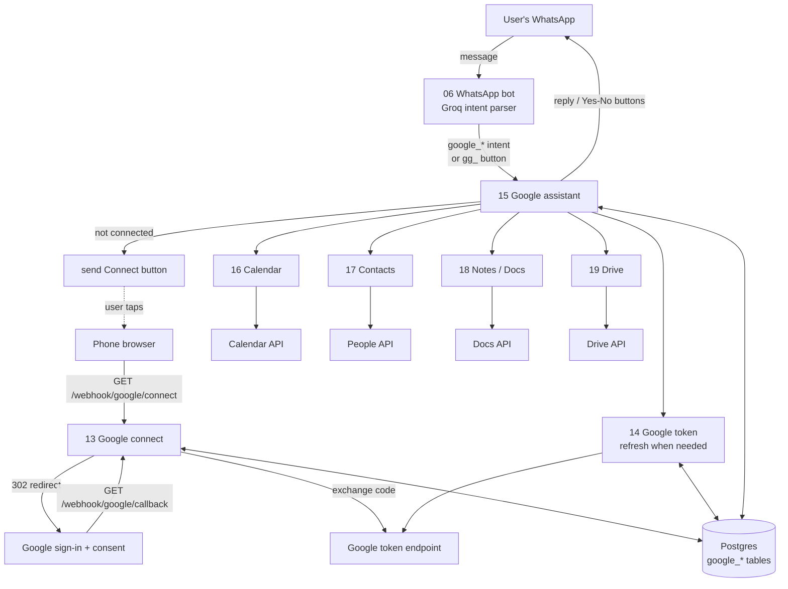
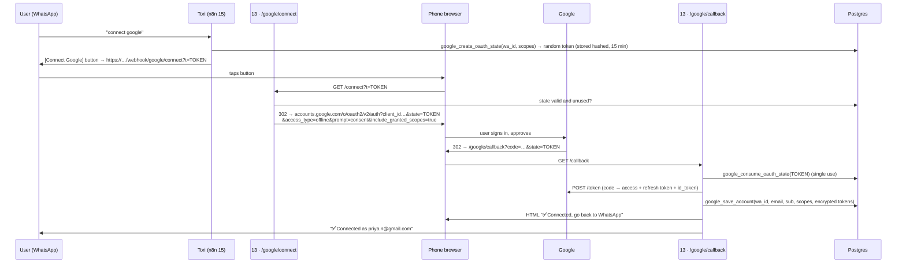

# Tori × Google · Architecture (draft for review)

**Status:** proposal, nothing built yet. Waiting for review and confirmation before work starts.
**Scope:** let a person connect their Google account to Tori on WhatsApp, so Tori can work with their
**Calendar, Contacts, Notes (Docs) and Drive**.

This builds on the existing system described in [Architecture.md](../../Architecture.md): the WhatsApp
bot (workflow 06), its Groq intent parser, and the Postgres-first design. Nothing in the booking-email
pipeline (workflows 01–05) changes.

## Contents

1. [Summary for review](#1-summary-for-review)
2. [Decisions needed before work starts](#2-decisions-needed-before-work-starts)
3. [Assumptions](#3-assumptions)
4. [What the user experiences](#4-what-the-user-experiences)
5. [The big picture](#5-the-big-picture)
6. [Google Cloud setup and permissions (scopes)](#6-google-cloud-setup-and-permissions-scopes)
7. [Connecting an account (OAuth)](#7-connecting-an-account-oauth)
8. [Storing and refreshing tokens](#8-storing-and-refreshing-tokens)
9. [The four services](#9-the-four-services)
10. [How the bot routes Google requests](#10-how-the-bot-routes-google-requests)
11. [Data model (migration 006)](#11-data-model-migration-006)
12. [New workflows](#12-new-workflows)
13. [Security and privacy](#13-security-and-privacy)
14. [Failure handling](#14-failure-handling)
15. [Testing](#15-testing)
16. [Build plan (step by step)](#16-build-plan-step-by-step)
17. [Known limits and later options](#17-known-limits-and-later-options)
18. [Sources](#18-sources)

---

## 1. Summary for review

A user types **"connect google"** on WhatsApp. Tori replies with a button. The user signs in to Google
in their phone's browser and approves access. From then on they can ask Tori in plain language:

| Service      | What the user can say                                                                           | What Tori does                                                                                                 |
| ------------ | ----------------------------------------------------------------------------------------------- | -------------------------------------------------------------------------------------------------------------- |
| **Calendar** | "What's on tomorrow?" · "Add dentist Tuesday 5 PM" · "Move my 5 PM to 6" · "Cancel the dentist" | Reads, creates, moves and deletes events in their main calendar. Asks "Yes / No" before any change.            |
| **Contacts** | "What's Rahul's number?" · "Save Priya 98765 43210"                                             | Searches and adds Google Contacts. Can also save a partner/travel match as a contact.                          |
| **Notes**    | "Note: buy shuttlecocks" · "Show my notes" · "Make a doc with today's plan"                     | Keeps notes in a **"Tori Notes" Google Doc** and can create new Docs. (Google Keep is not possible, see §9.3.) |
| **Drive**    | _(sends a photo or PDF)_ "Save this to Drive" · "Show my saved files"                           | Saves files sent on WhatsApp into a **"Tori" folder** in their Drive and lists or shares them.                 |

Five design choices:

1. **Each user connects their own Google account** with Google's standard sign-in and consent screen
   (OAuth). Tori never sees the user's password.
2. **Smallest permissions possible.** For Drive and Docs, Tori asks only for access to _files Tori
   creates_, not the whole Drive. This avoids Google's paid security audit (§6.3).
3. **Confirm before every change.** Tori never creates, edits or deletes anything without the user
   tapping **Yes**.
4. **Tokens are encrypted** in our database, and "disconnect google" revokes access at Google.
5. **Same pattern as travel matching:** the existing Groq call recognises the request, new n8n
   sub-workflows do the work, and the rules live in Postgres.

## 2. Decisions needed before work starts

| #   | Question                                                                                                                                                      | Recommendation                                                                                                          |
| --- | ------------------------------------------------------------------------------------------------------------------------------------------------------------- | ----------------------------------------------------------------------------------------------------------------------- |
| D1  | **Who connects Google?** End users of the WhatsApp bot, venue owners (tenants), or both?                                                                      | End users first. Venue owners could later use the same flow for the Tori Desk calendar (§17).                           |
| D2  | **Notes = Google Docs** instead of Google Keep. OK?                                                                                                           | Yes. Google's Keep API only works for company (Workspace) accounts managed by an admin, not for normal Gmail users.     |
| D3  | **Drive:** only files Tori saves (no audit), or search the user's _whole_ Drive (needs Google's paid CASA security audit, roughly 4–8 weeks, renewed yearly)? | Only Tori's files for now. Revisit when there is demand.                                                                |
| D4  | **Confirm every change** with a Yes / No button?                                                                                                              | Yes. An LLM can misread "cancel" or a date, and a wrongly deleted meeting is worse than one extra tap.                  |
| D5  | **Which Google Cloud project, company name, support email and website** appear on Google's consent screen?                                                    | A project owned by a Tori company Google account, not a personal Gmail. The website needs a privacy policy page (§6.2). |
| D6  | **Public HTTPS address.** Google needs a fixed sign-in return URL. The current Cloudflare quick tunnel changes its address on every restart.                  | A fixed domain, for example `api.<tori-domain>`, through a named Cloudflare tunnel or the production host.              |
| D7  | Which features from the reference video are **must-have in the first release**?                                                                               | Connect + Calendar first, then Contacts, Notes, Drive (§16).                                                            |

## 3. Assumptions

- **The reference video has not been reviewed in this document.** The design assumes it shows an
  assistant on WhatsApp that links a Google account and manages calendar, contacts, notes and files by
  chat. Anything in the video that differs (for example, a web dashboard or voice notes) should be
  listed against §1 so the plan can be adjusted.
- Users are identified by their WhatsApp number (`wa_id`, digits only), as in travel matching.
- One Google account per WhatsApp number.
- Users are mostly on personal Gmail accounts, so the Google app must be **External** (open to any
  Google account), not Internal.
- Timezone defaults to `Asia/Kolkata`; the user's own calendar timezone is used once connected.

## 4. What the user experiences

### 4.1 Connecting

```
User:  connect google
Tori:  Connect your Google account so I can manage your calendar, contacts,
       notes and Drive files. The link works once and expires in 15 minutes.
       [ Connect Google ]                      ← WhatsApp URL button
       (browser opens → Google sign-in → "Tori wants to access…" → Allow)
Browser: ✅ Connected. You can go back to WhatsApp.
Tori:  ✅ Connected as priya.n@gmail.com.
       Try: "What's on tomorrow?"   ·   Not you? Reply "disconnect google".
```

Google's consent screen lets the user untick individual permissions. If they untick Contacts, the
rest still works, and Tori asks again only when they first ask about contacts.

### 4.2 A change (always confirmed)

```
User:  add badminton with Rohan tomorrow 6 to 7 pm
Tori:  Add to your Google Calendar?
       🏸 Badminton with Rohan
       Wed 7 Oct, 6:00–7:00 PM
       [ Yes, add ]  [ No ]
User:  (taps Yes, add)
Tori:  ✅ Added. https://calendar.google.com/…
```

### 4.3 Other commands

| User says                              | Tori does                                                      |
| -------------------------------------- | -------------------------------------------------------------- |
| `google status`                        | Shows the connected email and which services are allowed.      |
| `disconnect google`                    | Revokes access at Google, deletes the stored tokens, confirms. |
| Any Google request while not connected | Explains what is needed and sends the Connect button.          |

## 5. The big picture



In words:

1. The existing Groq call in workflow 06 already classifies every free-text message. It learns new
   `google_*` intents and hands them to **workflow 15**, the same way travel intents go to workflow 07.
2. If the user has not connected Google, 15 creates a one-time link and sends it as a button.
3. **Workflow 13** serves that link: it redirects to Google, receives the user back, swaps the code for
   tokens and stores them encrypted.
4. For every Google call, 15 asks **workflow 14** for a valid access token. 14 refreshes it when it has
   expired.
5. 15 sends the actual work to one of four service workflows (16–19). Reads answer immediately.
   Changes are first saved as a _pending action_ and run only after the user taps **Yes**.

## 6. Google Cloud setup and permissions (scopes)

### 6.1 One-time setup

1. A Google Cloud project owned by a Tori company account (D5). The current calendar service account
   lives in a personal-Gmail project and should not be reused for this.
2. Enable: Google Calendar API, People API, Google Docs API, Google Drive API.
3. **OAuth consent screen ("Google Auth Platform → Branding / Audience")**: type **External**, app name
   "Tori", logo, support email, homepage, privacy policy and terms links, authorised domain.
4. **OAuth client** of type _Web application_, with the redirect URI
   `https://<fixed-domain>/webhook/google/callback` (D6). Its ID and secret go into `.env`.
5. While in **Testing** mode, add the testers' Gmail addresses as test users (up to 100).

### 6.2 Testing vs. published, and Google's review

| Mode                    | Who can connect         | Catch                                                                                                                                                                          |
| ----------------------- | ----------------------- | ------------------------------------------------------------------------------------------------------------------------------------------------------------------------------ |
| Testing                 | Only listed test users  | **Refresh tokens expire after 7 days.** Users would have to reconnect weekly. Fine for development only.                                                                       |
| Published, not verified | Anyone, up to 100 users | Google shows an "unverified app" warning screen.                                                                                                                               |
| Published + verified    | Anyone                  | Needs Google's review of the sensitive scopes: a verified domain, a homepage, a privacy policy explaining how Google data is used, and a short demo video of the consent flow. |

The review should be started as soon as Calendar and Contacts work, because it can take several weeks
and asks for changes.

### 6.3 Scopes

| Purpose               | Scope                                             | Google's class    | Why this one                                                                                                    |
| --------------------- | ------------------------------------------------- | ----------------- | --------------------------------------------------------------------------------------------------------------- |
| Who the user is       | `openid`, `email`                                 | non-sensitive     | Show "Connected as …" and detect account switches.                                                              |
| Calendar read + write | `https://www.googleapis.com/auth/calendar.events` | sensitive         | Events on the user's calendars. Not the full `calendar` scope, which can also share and delete whole calendars. |
| Contacts read + write | `https://www.googleapis.com/auth/contacts`        | sensitive         | Search and create contacts.                                                                                     |
| Notes + Drive         | `https://www.googleapis.com/auth/drive.file`      | **non-sensitive** | Only files Tori creates (or the user explicitly picks). Works for both the Docs API and the Drive API.          |

**Not requested:** `drive`, `drive.readonly`, `drive.metadata.readonly`. These are _restricted_ scopes:
they would let Tori search the whole Drive, but they require a yearly third-party CASA security
assessment on top of the normal review (D3). `documents` (all Docs) is also not needed, because
`drive.file` already covers the Docs Tori creates.

**Incremental consent.** Every connect link uses `include_granted_scopes=true`, so asking for one more
scope later keeps the earlier ones. Because the user can untick any scope on the consent screen, Tori
stores the scopes actually granted and checks them before each feature (§10.2).

## 7. Connecting an account (OAuth)



Details:

- **The link is the only secret.** 32 random bytes, stored as a SHA-256 hash, valid 15 minutes, usable
  once. It is also used as the OAuth `state`, which protects the callback against forged requests.
- **`access_type=offline` + `prompt=consent`** make Google return a refresh token every time, so a
  reconnect always replaces a broken token.
- **In-app browsers.** Google refuses sign-in inside embedded app browsers (`disallowed_useragent`).
  The link must open in Chrome/Safari or an Android Custom Tab. This has to be tested on real Android
  and iPhone WhatsApp builds. If a phone shows the error, the HTML page served by `/connect` detects it
  and tells the user to open the link in their browser.
- **Wrong person.** If a link is forwarded, whoever completes it connects _their_ Google to the sender's
  WhatsApp. The confirmation message always names the connected email, with "Not you? Reply disconnect
  google".
- n8n webhooks can answer with a 302 redirect or an HTML page (_Respond to Webhook_ node), so no
  separate web server is needed.

## 8. Storing and refreshing tokens

**Why not n8n's built-in Google credentials?** An n8n credential holds _one_ Google account and is
chosen when the workflow is built. Here every user has their own account, so tokens live in Postgres
and Google is called with plain HTTP Request nodes and an `Authorization: Bearer …` header. The project
already does this for the calendar service account (a Code node signs its own JWT).

**Encryption.** Refresh and access tokens are encrypted in an n8n Code node with AES-256-GCM
(`crypto` is already allowed in the container) using `GOOGLE_TOKEN_KEY` from `.env`. Postgres stores only
ciphertext, IV and auth tag. The key never reaches the database, its logs or backups.

**Workflow 14 · Google token** (sub-workflow, called before every Google request):

```
input: wa_id, needed_scope
  │
  ├─ no account / status ≠ connected      → { error: "not_connected" }
  ├─ needed_scope not in granted scopes   → { error: "scope_missing", scope }
  ├─ access token valid > 60 s more       → { access_token }
  └─ else POST oauth2.googleapis.com/token (grant_type=refresh_token)
        ├─ 200          → save new access token + expiry → { access_token }
        ├─ invalid_grant → status = revoked, log it      → { error: "reconnect_needed" }
        └─ 5xx / timeout → retry 2× with backoff         → { error: "google_unavailable" }
```

Two parallel refreshes for one user are harmless: Google allows several valid access tokens at once.

**Disconnect.** `disconnect google` → POST `https://oauth2.googleapis.com/revoke` with the refresh
token → delete the encrypted tokens → status `disconnected`. If the user removes Tori in their Google
account settings instead, the next refresh fails with `invalid_grant` and Tori marks the account
`revoked` and offers to reconnect.

## 9. The four services

All calls go through workflow 14 for a token. Google's IDs for created items (event ID, contact
`resourceName`, file ID) are stored on the pending action so a retry never creates a duplicate.

### 9.1 Calendar (workflow 16) · `calendar.events`

| Action                                                | API call                                                                                                     | Confirm? |
| ----------------------------------------------------- | ------------------------------------------------------------------------------------------------------------ | -------- |
| List events for a day / range ("what's on tomorrow?") | `GET calendars/primary/events?timeMin&timeMax&singleEvents=true&orderBy=startTime`                           | no       |
| Am I free at …?                                       | same list call, check for overlaps                                                                           | no       |
| Create                                                | `POST calendars/primary/events` with a client-chosen `id` (base32hex from the pending action ID)             | **yes**  |
| Move / rename                                         | find candidates by `q=` + date → if more than one, the user picks from a WhatsApp list → `PATCH events/{id}` | **yes**  |
| Delete                                                | find as above → `DELETE events/{id}`                                                                         | **yes**  |

- The client-chosen event ID follows the existing rule "calendar event IDs are deterministic": if n8n
  retries a create, Google answers 409 and nothing is duplicated.
- Times are read and written in the user's calendar timezone, fetched once at connect from
  `GET users/me/settings/timezone`.
- **Tie-in with existing features:** after a partner or travel match is confirmed, or a venue booking
  is paid, Tori can offer "📅 Add to Google Calendar" to connected users.

### 9.2 Contacts (workflow 17) · `contacts`

| Action                            | API call                                                                             | Confirm? |
| --------------------------------- | ------------------------------------------------------------------------------------ | -------- |
| Find ("Rahul's number")           | `GET people:searchContacts?query=…&readMask=names,phoneNumbers,emailAddresses`       | no       |
| Create ("save Priya 98765 43210") | `POST people:createContact`                                                          | **yes**  |
| Send a contact card               | Tori replies with a WhatsApp `contacts` message, so the user can tap to call or save | no       |

- Google's contact search needs a "warm-up" call (an empty query) before the first real search
  returns results. 17 sends it once after connect.
- Phone numbers are normalised to `+91…` before saving.

### 9.3 Notes (workflow 18) · `drive.file`

**Google Keep is not possible for normal users.** The Keep API is only for Workspace (company)
administrators, with domain-wide delegation. So notes live in Google Docs:

| Action                                        | How                                                                                       | Confirm?                                                                                       |
| --------------------------------------------- | ----------------------------------------------------------------------------------------- | ---------------------------------------------------------------------------------------------- |
| First note                                    | Create a Doc "Tori Notes" inside the user's "Tori" folder; save its ID on the account row | no (part of the first note)                                                                    |
| Add a note                                    | Docs `batchUpdate` → insert "📝 6 Oct 2026, 9:14 PM" + the text at the top                | no: adding a note is cheap and harmless. Tori replies with what it saved and an "Undo" button. |
| Show / search notes                           | Docs `GET` → plain text → latest 10, or lines containing the search words                 | no                                                                                             |
| New document ("make a doc with today's plan") | Create a Doc with the title and text (the LLM may draft the text) → reply with the link   | **yes** (shows title + first lines)                                                            |

Tori can only open Docs it created itself. Docs the user made elsewhere are out of reach unless D3 changes.

### 9.4 Drive (workflow 19) · `drive.file`

| Action                       | How                                                                                                                                        | Confirm?                                                        |
| ---------------------------- | ------------------------------------------------------------------------------------------------------------------------------------------ | --------------------------------------------------------------- |
| Save a file sent on WhatsApp | download the media from the WhatsApp Graph API → upload to the "Tori" folder (multipart up to 5 MB, resumable above) → reply with the link | **yes**, unless the user's message already said "save to Drive" |
| List saved files             | `GET files?q='<tori folder>' in parents&orderBy=createdTime desc`                                                                          | no                                                              |
| Share a file                 | `POST files/{id}/permissions` (reader, by email)                                                                                           | **yes**                                                         |

- The "Tori" folder is created at the first save and its ID is stored on the account row.
- Large files pass through n8n's memory. A size cap (`GOOGLE_DRIVE_MAX_MB`, default 25) keeps the
  container healthy.

## 10. How the bot routes Google requests

### 10.1 Changes to workflow 06 (generated by `plan/build_partner_workflow.py`)

1. **`Build LLM request`**: the existing Groq prompt gains intents and fields:
   `google_connect`, `google_disconnect`, `google_status`, `calendar_list`, `calendar_create`,
   `calendar_update`, `calendar_delete`, `contact_find`, `contact_create`, `note_add`, `note_list`,
   `doc_create`, `drive_save`, `drive_list`. The fields extracted are title, start, end, date range,
   person name, phone and note text, depending on the intent.
2. **`Partner route`**: new output 7 `google` → Execute workflow `toriGoogleAssist` (15).
3. **`Google button?`**: a new check next to `Travel button?` catches button IDs starting with `gg_`
   (Yes / No / pick-one-of-several) and sends them straight to 15.
4. **Media messages** (image / document) with a caption like "save" or "drive", or followed by "save
   this", go to 15 as `drive_save`.

No existing `Switch` rule is reordered, the same approach as partner and travel matching.

### 10.2 Inside workflow 15 · Google assistant

```
intent in
  ├─ connect / disconnect / status      → handle directly
  ├─ get token (14)
  │    ├─ not_connected      → explain + Connect button
  │    ├─ scope_missing      → "Allow Tori to use your contacts?" + Connect button for that scope only
  │    └─ reconnect_needed   → "Your Google connection expired" + Connect button
  ├─ read intent  → service workflow → format reply (code, not the LLM) → WhatsApp
  └─ write intent → google_create_action(wa_id, service, action, payload)
                    → summary + [Yes] [No] buttons (gg_yes_<id>, gg_no_<id>)
gg_yes_<id> → google_claim_action(id)   ← atomic; a double tap runs it once
           → service workflow → google_complete_action(id, result | error) → reply
gg_no_<id>  → status = cancelled → "OK, nothing changed."
```

Pending actions expire after 10 minutes. A tap after that gets "That request expired, please ask again."

## 11. Data model (migration 006)

New files, following the travel pattern: `db/migrations/006_google.sql` (tables) and
`db/migrations/006_google_functions.repeatable.sql` (functions). Public schema, prefix `google_`.

```sql
google_accounts (
  id                 uuid PK,
  wa_id              text UNIQUE NOT NULL,          -- WhatsApp number, digits only
  google_sub         text,                          -- Google's stable user ID (from id_token)
  email              text,
  granted_scopes     text[] NOT NULL DEFAULT '{}',
  refresh_token_enc  bytea,                         -- AES-256-GCM: iv || tag || ciphertext
  access_token_enc   bytea,
  access_expires_at  timestamptz,
  timezone           text DEFAULT 'Asia/Kolkata',
  tori_folder_id     text,                          -- Drive folder "Tori"
  notes_doc_id       text,                          -- Doc "Tori Notes"
  status             text CHECK (status IN ('connected','revoked','disconnected')),
  connected_at, last_used_at, updated_at timestamptz,
  last_error         text
)

google_oauth_states (
  token_hash         bytea PK,                      -- sha256 of the link token
  wa_id              text NOT NULL,
  scopes_requested   text[] NOT NULL,
  created_at, expires_at, used_at timestamptz
)

google_actions (                                   -- pending / done changes
  id                 uuid PK,
  wa_id              text NOT NULL,
  service            text CHECK (service IN ('calendar','contacts','notes','drive')),
  action             text NOT NULL,                 -- create / update / delete / share …
  payload            jsonb NOT NULL,                -- what to send to Google
  summary            text NOT NULL,                 -- what the user was shown
  status             text CHECK (status IN ('pending','running','done','failed','cancelled','expired')),
  google_resource_id text,                          -- event id, resourceName, file id
  error              text,
  created_at, expires_at, finished_at timestamptz
)

google_events (                                    -- audit log, no Google content
  id bigserial PK, wa_id text, kind text, detail jsonb, at timestamptz DEFAULT now()
)
```

Functions (all business rules, as in 002/005): `google_create_oauth_state`,
`google_consume_oauth_state`, `google_save_account`, `google_account_for(wa_id)`,
`google_mark_revoked`, `google_create_action`, `google_claim_action` (`UPDATE … WHERE status =
'pending' AND expires_at > now() RETURNING …`), `google_complete_action`, `google_expire_sweep`,
`google_purge(30)` (clears `payload` of finished actions after 30 days).

## 12. New workflows

Generated by a new `plan/build_google_workflows.py`, like `build_travel_workflows.py`.

| #   | ID                   | Trigger                                                | Does                                                        |
| --- | -------------------- | ------------------------------------------------------ | ----------------------------------------------------------- |
| 13  | `toriGoogleConnect`  | webhooks `GET /google/connect`, `GET /google/callback` | OAuth start + callback (§7)                                 |
| 14  | `toriGoogleToken`    | called                                                 | valid access token or an error code (§8)                    |
| 15  | `toriGoogleAssist`   | called by 06                                           | routing, connect prompts, confirmations (§10.2)             |
| 16  | `toriGoogleCalendar` | called by 15                                           | Calendar API (§9.1)                                         |
| 17  | `toriGoogleContacts` | called by 15                                           | People API (§9.2)                                           |
| 18  | `toriGoogleNotes`    | called by 15                                           | Docs API (§9.3)                                             |
| 19  | `toriGoogleDrive`    | called by 15                                           | Drive API + WhatsApp media download (§9.4)                  |
| 20  | `toriGoogleSweep`    | every 15 min                                           | expire pending actions and OAuth states, purge old payloads |

New `.env` settings (defaults pointing at the mock in `.env.example`):

| Variable                                               | Meaning                                                                                       |
| ------------------------------------------------------ | --------------------------------------------------------------------------------------------- |
| `GOOGLE_OAUTH_CLIENT_ID`, `GOOGLE_OAUTH_CLIENT_SECRET` | the Web OAuth client (§6.1)                                                                   |
| `GOOGLE_PUBLIC_BASE_URL`                               | fixed HTTPS address; the redirect URI is this + `/webhook/google/callback`                    |
| `GOOGLE_AUTH_URL`                                      | `https://accounts.google.com/o/oauth2/v2/auth` (mock in dev)                                  |
| `GOOGLE_TOKEN_URI`                                     | already exists; reused                                                                        |
| `GOOGLE_API_BASE`                                      | `https://www.googleapis.com` (Calendar, Drive), plus `GOOGLE_PEOPLE_BASE`, `GOOGLE_DOCS_BASE` |
| `GOOGLE_TOKEN_KEY`                                     | 32-byte base64 key for token encryption                                                       |
| `GOOGLE_ENABLED`                                       | `1` = route `google_*` intents to 15; `0` = "coming soon" reply                               |
| `GOOGLE_DRIVE_MAX_MB`                                  | upload size cap, default 25                                                                   |

## 13. Security and privacy

- **Least privilege.** Only the four scopes in §6.3. No restricted scopes.
- **Encrypted tokens** (§8). The `GOOGLE_TOKEN_KEY` is kept like the other secrets, in `.env` only.
- **Single-use, short-lived connect links** that double as the OAuth `state`.
- **No Google content stored by Tori.** Events, contacts, notes and files are read live and not copied
  into Postgres. Exceptions: IDs, and the pending action's `payload`, which is purged 30 days after it
  finishes. n8n execution logs do contain content, so workflows 14–19 save successful executions'
  data as _none_ and keep error executions (already pruned after 14 days).
- **The LLM cannot act by itself.** Groq only reads the user's own message. Text that comes _from_
  Google (an event title, a note) is formatted by code, never sent back to the LLM as instructions, and
  every change needs the user's tap. Someone who shares a calendar invite saying "delete all events"
  cannot make Tori delete anything.
- **Google's user-data policy (Limited Use).** Google data may only be used to provide the features the
  user asked for, may not be sold, and may not be used to train AI models. Sending a user's message to
  Groq is allowed for that feature. The privacy policy must say so, and Groq's API data terms need
  checking before release.
- **India DPDP Act.** Consent is explicit (Google's screen plus Tori's own wording). Disconnect is
  one message and deletes tokens. `google_events` holds no content.

## 14. Failure handling

| Failure                                                                                | Response                                                                                                                                                                   |
| -------------------------------------------------------------------------------------- | -------------------------------------------------------------------------------------------------------------------------------------------------------------------------- |
| Access token expired (401)                                                             | 14 refreshes once and the call is retried once.                                                                                                                            |
| `invalid_grant` on refresh (user revoked, password change, Testing mode's 7-day limit) | Account → `revoked`, user gets a Reconnect button.                                                                                                                         |
| 403 insufficient scope                                                                 | Ask for that one scope (incremental consent).                                                                                                                              |
| 429 / 5xx from Google                                                                  | n8n retry-on-fail, 3 tries with backoff, then "Google isn't responding, try again in a minute." The pending action stays `failed` and can be retried by tapping Yes again. |
| Event to move or delete is ambiguous                                                   | Show up to 10 matches as a WhatsApp list. Never pick one silently.                                                                                                         |
| Groq rate limit (free tier ~8k tokens/min)                                             | Same handling as today. The extra intents add prompt length, so the prompt must stay compact.                                                                              |
| WhatsApp 24-hour window closed                                                         | Replies are always answers to a user message, so they fall inside the window. No template needed except the optional "Add to calendar" offer after a match.                |

## 15. Testing

- **Mock Google** in [mock-apis/server.js](../../mock-apis/server.js), next to the existing mock Google
  token + Calendar: an auth page that auto-approves and redirects back, refresh-token grants
  (including a switch to return `invalid_grant`), People search/create, Docs create/get/batchUpdate,
  Drive folder/upload/list/permissions, revoke.
- **`scripts/google-e2e.sh`**: a throwaway compose project like `travel-e2e.sh`, with mock WhatsApp
  - mock Google and real Groq. Scenarios: connect, connect with a scope unticked, list/create/move/delete
    event, double-tap Yes, expired confirmation, contact find/create, notes add/list, Drive save/list,
    revoked token → reconnect, disconnect.
- **SQL tests** for the action state machine in `db/tests/google.sql`.
- **Manual test on real phones** (Android and iPhone) for the connect link and the in-app browser
  issue (§7), with a real Google test user, before any release.

## 16. Build plan (step by step)

Each phase ends with a demo on WhatsApp before the next one starts.

| Phase                           | Steps                                                                                                                                         | Done when                                                                                                    |
| ------------------------------- | --------------------------------------------------------------------------------------------------------------------------------------------- | ------------------------------------------------------------------------------------------------------------ |
| **0 · Prerequisites** (no code) | Decisions D1–D7 · fixed HTTPS domain · company Google Cloud project · consent screen in Testing mode · privacy-policy page · test users added | Redirect URI registered, OAuth client in `.env`                                                              |
| **1 · Connect + Calendar**      | Migration 006 · mock Google · workflows 13, 14, 15, 16, 20 · 06 changes · `google-e2e.sh`                                                     | A tester connects on a real phone, lists, adds, moves and deletes events with confirmations, and disconnects |
| **2 · Contacts**                | Workflow 17 · "save match as contact"                                                                                                         | Find and save contacts; contact cards in chat                                                                |
| **3 · Notes (Docs)**            | Workflow 18                                                                                                                                   | Notes added and listed in "Tori Notes"; new Doc created with a link                                          |
| **4 · Drive**                   | Workflow 19 · media handling in 06                                                                                                            | Photo/PDF saved to the "Tori" folder, listed, shared                                                         |
| **5 · Google review**           | Demo video, privacy policy final, submit for verification of the sensitive scopes                                                             | App verified; the 100-user cap and warning screen are gone                                                   |
| **6 · Go live**                 | Deploy to the live stack (also still pending: travel 07–12, migration 005) · `GOOGLE_ENABLED=1`                                               | Real users can connect                                                                                       |

Phase 5 can start right after phase 2: Google's review is the longest wait. Submit all four scopes
in one go (`drive.file` is non-sensitive, so including it early adds no extra review work), so that
Notes and Drive don't trigger a second review later.

## 17. Known limits and later options

- **No Google Keep.** Not available to apps for personal accounts (§9.3).
- **No whole-Drive or all-Docs search** without restricted scopes and a CASA audit (D3). A middle
  option is a small web page with Google Picker, where the user picks specific files to give Tori
  (still `drive.file`, no audit).
- **One Google account per WhatsApp number.**
- **Main calendar only** in phase 1. Other calendars can be added with a "which calendar?" setting.
- **Gmail** is not in scope. Reading mail uses restricted scopes (audit), and sending mail uses a
  sensitive scope.
- **Venue owners (Tori Desk).** Today the venue calendar works by sharing it with a service account,
  which some company Google accounts block. Later, owners could use this same connect flow instead, and
  workflow 03 would write with their token.

## 18. Sources

- Google OAuth scopes list: https://developers.google.com/identity/protocols/oauth2/scopes
- Drive scopes and their classes (`drive.file` non-sensitive; `drive.readonly`,
  `drive.metadata.readonly` restricted): https://developers.google.com/workspace/drive/api/guides/api-specific-auth
- Docs API scopes (`drive.file` supported and recommended): https://developers.google.com/workspace/docs/api/auth
- Keep API is for enterprise administrators: https://developers.google.com/workspace/keep/api/guides
- Google blocks OAuth in embedded webviews (`disallowed_useragent`):
  https://developers.googleblog.com/2021/06/upcoming-security-changes-to-googles-oauth-2.0-authorization-endpoint.html
- Restricted scopes and the CASA assessment:
  https://nango.dev/docs/api-integrations/google-shared/google-security-review
