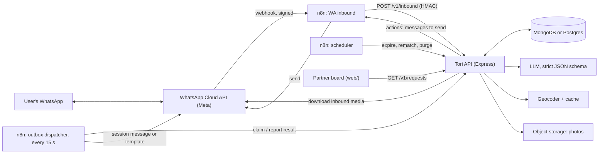
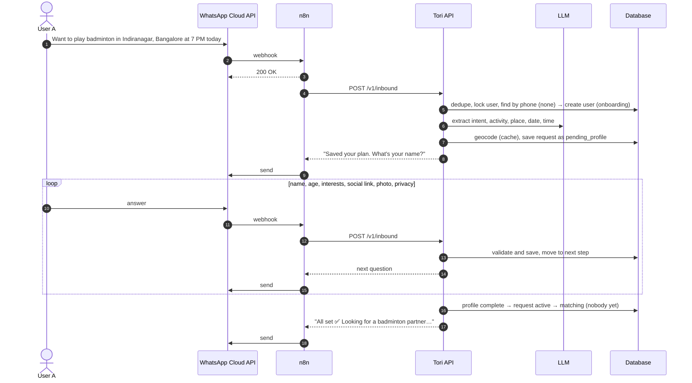
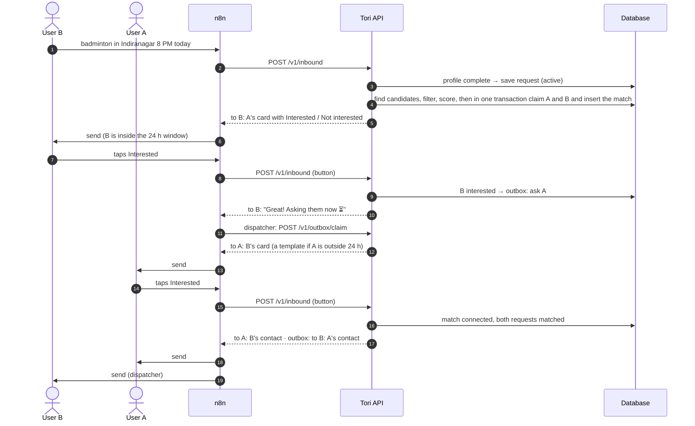

# Tori matching platform: architecture v2

Status: **partly built on n8n + Postgres (2026-10-14)**: onboarding v2 (name, link, photo, privacy), profile
cards, sequential consent, radius + 2-hour matching, held messages for people outside the 24-hour window
(migrations 008–009, workflow 06). Not built yet: the Express backend (§2, §7–8), location-ambiguity
buttons, profile editing, report / block. Originally a proposal, 2026-10-14. **Decided 2026-10-14:** Postgres; any age; photo and social link optional and hidden
until both say yes by default; gender kept. Builds on what already runs in this repo (workflow 06, `db/migrations/004–007`,
`web/`). Covers the brief "WhatsApp-based social activity matching": onboarding with name, age, interests,
social link and photo; matching within a radius and a 2-hour window; a profile card for the new user and
mutual consent.

Contents: [0 Requirements](#0-requirements-confirmed-vs-assumed) ·
[1 Today vs v2](#1-what-exists-today-and-what-v2-changes) · [2 Architecture](#2-architecture-and-data-flow) ·
[3 Conversations](#3-whatsapp-conversation-flows) · [4 Data model](#4-data-model-mongodb) ·
[5 Extraction](#5-activity-extraction-and-location-normalisation) · [6 Matching](#6-matching-algorithm) ·
[7 n8n](#7-n8n-workflows) · [8 API](#8-rest-api) · [9 Concurrency](#9-simultaneous-requests-and-duplicate-matches) ·
[10 Expiry](#10-expiration) · [11 Privacy and WhatsApp](#11-consent-privacy-and-whatsapp-constraints) ·
[12 Edge cases](#12-edge-cases) · [13 Production](#13-scaling-and-production-readiness) ·
[14 MVP plan](#14-mvp-implementation-plan)

---

## 0. Requirements: confirmed vs assumed

**Confirmed (from the brief)**

| # | Requirement |
|---|---|
| C1 | Channel: WhatsApp Business Cloud API. A user is identified by their WhatsApp number. |
| C2 | New users give name, age, interests, LinkedIn or Instagram URL and a profile photo, conversationally. |
| C3 | Each request yields activity, location, date and preferred time, and is stored as active. |
| C4 | Matching: same or compatible activity; same place or within a radius; same date; time difference within a configurable window (2 h); both requests active; never the same user. |
| C5 | The user who posts second (B) gets the first (A)'s profile card with **Interested** / **Not interested**. |
| C6 | Mutual consent. Profile details are shared according to each user's privacy preferences. |
| C7 | Stack under consideration: Node.js/Express, MongoDB, n8n, WhatsApp Cloud API, an LLM for extraction. |
| C8 | Matching lives in the backend, not in n8n. Deterministic rules; an LLM only for language understanding. |

**Assumed (mine; each needs a yes/no)**

| # | Assumption | Why |
|---|---|---|
| A1 | India first: default time zone Asia/Kolkata; messages in English, Hindi or Hinglish. | Current users and data. |
| A2 | ~~18+ only~~ **Decided: any age.** No age restriction on matching. | Product decision. Risk to revisit: adults matched with minors, and DPDP's verifiable parental consent for under-18s' data. |
| A3 | **Decided:** social URL and photo are optional ("Skip" button). Name, age and interests are required. | Every extra required step loses users; a missing photo shouldn't block a game. |
| A4 | Before consent, the card shows first name, age, interests, area and time. Photo and social URL are shown before consent **only if their owner chose that**; the default is after consent. The phone number is shown only after both say yes. | The brief's card shows the photo and URL; C6 says the owner decides. The safe default is after consent. |
| A5 | Consent is sequential: B (the newest, who is chatting right now) is asked first; A is asked only after B says Interested. | A isn't disturbed by people who aren't interested, and B is inside the 24-hour window so a free-form card works. |
| A6 | Radius: 3 km between the two places' centres, same city. Configurable. | Typical for a sports meetup in Indian cities. |
| A7 | "Within 2 hours" is the gap between the two time ranges. Exact times are a point ("7 PM"); vague ones a range ("evening" = 16:00–20:00). | Works for exact and vague times alike (§6.2). |
| A8 | One partner per request in the MVP. Groups ("need 3 more") come later. | Keeps consent and matching simple. |
| A9 | One live request per user, activity and day; a newer one replaces the older. | Same as today. |
| A10 | **Decided:** gender is still collected, as today (male, female, non-binary, other, prefer not to say). | Kept from the current onboarding. |

---

## 1. What exists today, and what v2 changes

| Capability | Today (this repo) | v2 |
|---|---|---|
| WhatsApp in/out | n8n workflow 06 (281 nodes): webhook, routing, LLM call, replies | n8n stays a thin pipe: receive → backend → send. No business decisions in n8n. |
| Business logic | Split between n8n Code nodes and Postgres functions (`004`, `006`) | One Express service with tests |
| Profile | `tori_users`: age (birth year), gender, interests; asked before the first request | + name step, social URL, photo, privacy choices |
| Request extraction | One Groq call with a strict JSON schema; date and time resolved in Asia/Kolkata | Same idea, moved into the backend; adds geocoding |
| Location | City + `area_key` text equality (Indira Nagar = Indiranagar) | Geocoded point + radius; text equality as fallback |
| Time rule | ±30 min windows must overlap (exact times < 60 min apart) | Configurable gap, default 120 min |
| Matching concurrency | Advisory lock per (activity, city, date) plus `FOR UPDATE` | Conditional "claim" updates in a transaction (§9) |
| Consent | Both people get Yes/No at the same time; numbers shared after both say yes | B first, then A; profile card; privacy-aware |
| Expiry | 15-min job: proposals 2 h, requests after their time, drafts 30 min | Same rules, run by the backend |
| Board | `web/` (Next.js) reads `v_partner_board` | Reads `GET /v1/requests` instead |
| Already reusable | Prompt and validation in `plan/build_partner_workflow.py`; rules in `004_partner_matching.sql`; geocoding with cache and haversine (`005_travel_*`); outbox pattern (`tori.outbox`); e2e harness with mock WhatsApp (`scripts/travel-e2e.sh`) | |

### Database: recommendation

**Decided: Postgres.** The Express service goes on top of the existing tables. Reasons:

1. Matching is a transaction over three rows (claim the candidate, claim my request, insert the match).
   Postgres does this with row locks today. The rules are already written and tested (32 SQL checks plus the
   end-to-end test).
2. The data, the board and the travel flow are already there. Moving to MongoDB means a migration and a
   second database to run.
3. Radius search: the haversine function and geocode cache exist (`005`); PostGIS is one extension away.

MongoDB works too if the team prefers it. It needs a **replica set** for transactions (Atlas, or a single-node
replica set locally). It brings `2dsphere` indexes for the radius and flexible profile documents. Section 4 gives
the MongoDB schemas, as the brief asks, with the matching Postgres table for each. Everything else in this
document applies to either database.

---

## 2. Architecture and data flow



### Who does what

| Component | Owns | Never does |
|---|---|---|
| **Meta Cloud API** | Delivers user messages to the webhook; sends ours | |
| **n8n** | Verifies Meta's signature, answers 200 at once, normalises the payload, calls the API, sends what the API returns, retries sends, runs schedules, alerts | Decide anything about users, requests or matches |
| **Tori API (Express)** | Conversation state, profiles, extraction, geocoding, matching, consent, privacy, rendering messages, outbox | Talk to Meta's webhook directly (n8n is the edge) |
| **Database** | Users, requests, matches, outbox, dedupe log, geocode cache | |
| **LLM** | Free text → structured fields | Pick matches, decide state, write messages |

n8n stays because the team already runs it, it gives visual retries and logs, and it holds the WhatsApp
credentials. At scale the API can send messages itself (§13).

### One message, end to end

1. Meta POSTs the webhook. **n8n** checks `X-Hub-Signature-256` with the app secret and replies 200 straight away.
   Meta retries anything that doesn't get a fast 200, so this must not wait for the backend.
2. n8n normalises the payload to
   `{ waMessageId, from, profileName, timestamp, type, text, buttonId, media: { id, mimeType }, location }`.
3. n8n calls `POST /v1/inbound`, signed with a shared HMAC secret.
4. The **API** inserts `waMessageId` into the dedupe log. If it's already there, it returns `{ actions: [] }`.
5. The API takes a short **per-user lock**, so two quick messages from one person are handled in order.
6. It loads the user and their conversation state, then routes the message:
   - a button tap goes straight to its handler (no LLM);
   - an answer the current state expects (age, URL, photo) gets a deterministic check;
   - free text goes to the LLM.
7. It writes the changes, and runs matching when a request became active. It renders the replies for this user
   and puts messages for *other* users into the **outbox**.
8. It returns `{ actions: [...] }`. n8n sends each action and reports the WhatsApp message IDs back
   (`POST /v1/outbound/results`).
9. The **dispatcher** (n8n, every 15 s, or right away when the API pings it) claims outbox messages, sends them as
   a session message or a template, and reports the result. The API decides retries.

---

## 3. WhatsApp conversation flows

### 3.1 New user A: request first, then onboarding



```
A:    Want to play badminton in Indiranagar, Bangalore at 7 PM today.
Tori: Hey, I'm Tori 👋 I've saved your plan: badminton today around 7 PM in Indiranagar.
      A few quick questions so I can find you the right partner. What's your name?
A:    Harsh
Tori: Nice to meet you, Harsh! How old are you?
A:    21
Tori: What do you like to play or do? (e.g. badminton, football, running)
A:    badminton and football
Tori: Add your Instagram or LinkedIn so partners know who they're meeting.        [Skip]
A:    instagram.com/harsh.k
Tori: Last one: send a profile photo 📷                                            [Skip]
A:    <photo>
Tori: Who can see your photo and Instagram before you both agree to connect?
      [Anyone I match with]  [Only after we both say yes]
A:    (taps "Only after we both say yes")
Tori: All set ✅ Looking for a badminton partner today around 7 PM near Indiranagar.
      I'll message you here as soon as I find someone.
```

How the steps are checked:

- **One question at a time, but anything is accepted.** If a reply holds several answers ("Harsh, 21, badminton"),
  the LLM extracts them all and those steps are skipped.
- **Deterministic checks:**
  - age: a whole number from 10 to 100 (no minimum age, A2);
  - social link: must match `instagram.com/<handle>` or `linkedin.com/in/<slug>`, then normalised to a full URL;
    a bare `@handle` is taken as Instagram;
  - photo: an `image` message, under 5 MB.
- **The LLM** handles only messy free text: interests, a name inside a sentence.
- **Consent notice** at the first question: "By continuing you agree to Tori's privacy policy <link>. Reply STOP
  any time." This covers India's DPDP Act.

### 3.2 Returning user

```
A:    football tomorrow 6 pm koramangala
Tori: Got it! Looking for a football partner tomorrow around 6 PM near Koramangala, Bangalore. ⚽
      (Playing as Harsh, 21. Reply "profile" to change it.)
```

- **Missing details:** only those are asked, at most two questions per message ("What time works for you?").
  The answer merges into the draft.
- **Profile changes:** "profile" opens a list (name, age, interests, social, photo, privacy).

### 3.3 User B, match, consent



The card B receives: an interactive button message, with A's photo as the image header only if A allows it before consent:

```
Hey! We found someone who wants to play badminton near Indiranagar 🏸

Name: Harsh
Age: 21
Interests: badminton, football
Preferred time: today, around 7 PM
Instagram: shared once you both say yes

Would you like to connect?
[Interested]  [Not interested]
```

| Situation | What happens |
|---|---|
| B: Not interested | The match is declined. A never heard of it, so nothing is sent to A. Both requests go back to active; this pair isn't proposed again for 7 days. B is offered the next candidate. |
| B: Interested | B: "Great, asking them now". A gets B's card, using B's privacy choices. |
| A: Not interested | B: "They can't make it this time; I'm still looking for you." Both go back to active. |
| A: Interested | Both: "✅ It's a match! Say hi 👉 wa.me/<number>", plus the photo and social link if their owner allowed them after consent. Both requests become matched. |
| Nobody answers | B has 2 h, or until 30 min before the game, whichever is first; then A has the same. On timeout, whoever said Interested goes back to active and is matched again. |
| Old or foreign button | "This match isn't available any more." |

### 3.4 Other commands

`cancel` / `stop looking` (cancels requests and live matches; the other side is re-matched) ·
`make it 8 pm` (updates the request; §12) · `profile` · `help` · `delete my data` (§11) · `STOP` (no more
business-initiated messages) · after a match: **Report** and **Block** buttons.

---

## 4. Data model (MongoDB)

Seven collections. The Postgres table each one maps to is listed after the schemas.

### `users`

```js
{
  _id: ObjectId,
  phone: "+919812345678",            // E.164, unique: the identity
  waId: "919812345678",              // as Meta sends it
  waProfileName: "Harsh K",          // updated on every message; fallback display name
  name: "Harsh",
  birthYear: 2005,                   // stored instead of age so it doesn't go stale
  interests: ["badminton", "football"],   // canonical activity ids
  social: { kind: "instagram", url: "https://instagram.com/harsh.k", handle: "harsh.k" },  // or null
  photo: {                           // or null
    key: "users/66f…/1697012345.jpg",      // object storage key; served by signed URL
    mimeType: "image/jpeg", bytes: 183402, uploadedAt: ISODate,
    moderation: "pending" | "approved" | "rejected"
  },
  privacy: {                         // who sees what, before mutual consent
    photo:  "before_consent" | "after_consent" | "never",    // default after_consent
    social: "before_consent" | "after_consent" | "never",    // default after_consent
    age:    "before_consent" | "after_consent"               // default before_consent
  },
  profileStatus: "incomplete" | "complete",
  homeCity: "bangalore",             // learnt from requests; fills a missing city
  timezone: "Asia/Kolkata",
  conversation: {                    // embedded: one document = one lock
    state: "idle" | "onboarding" | "request_details" | "choose_place" | "profile_edit",
    step: "name" | "age" | "interests" | "social" | "photo" | "privacy" | null,
    pendingRequestId: ObjectId | null,
    context: {},                     // e.g. place candidates offered as buttons
    lockedUntil: ISODate | null      // per-user lock (§9)
  },
  lastInboundAt: ISODate,            // WhatsApp 24-hour window
  optIn: { messages: true, at: ISODate, policyVersion: "2026-10" },
  blockedUserIds: [ObjectId],
  status: "active" | "deleted" | "banned",
  createdAt: ISODate, updatedAt: ISODate
}
// indexes
{ phone: 1 }            unique
{ interests: 1 }
{ status: 1 }
```

### `activityRequests`

```js
{
  _id: ObjectId,
  userId: ObjectId,
  status: "draft" | "pending_profile" | "active" | "matching" | "matched" | "cancelled" | "expired",
  liveKey: "66f…|badminton|2026-10-14",   // set while live, unset when closed → one live request per user/activity/day
  rawText: "Want to play badminton in Indiranagar…",
  sourceMessageId: "wamid.HBg…",
  activity: "badminton",                  // canonical id from `activities`
  category: "racket",
  place: {
    text: "Indiranagar, Bangalore",       // as understood
    area: "Indiranagar", areaKey: "indiranagar", city: "bangalore",
    point: { type: "Point", coordinates: [77.6408, 12.9784] },   // [lng, lat]; absent if not geocoded
    precision: "pin" | "area" | "city" | "text",                 // how sure we are (§5.2)
    source: "nominatim" | "google" | "whatsapp_pin"
  },
  date: "2026-10-14",                     // local date in the user's time zone
  time: { kind: "exact" | "part_of_day", local: "19:00", part: null, label: "around 7 PM" },
  rangeStart: ISODate, rangeEnd: ISODate, // the time range in UTC (exact: start = end)
  expiresAt: ISODate,                     // rangeEnd + 30 min
  playersNeeded: 1, skill: null, notes: null,
  version: 1,                             // +1 whenever activity, place or time changes
  createdAt: ISODate, updatedAt: ISODate
}
// indexes
{ "place.point": "2dsphere", activity: 1, date: 1, status: 1 }   // candidate search
{ liveKey: 1 }                 unique, sparse
{ userId: 1, status: 1 }
{ status: 1, expiresAt: 1 }                                       // expiry job
```

### `matches`

```js
{
  _id: ObjectId,
  pairKey: "<smaller request id>|<larger request id>",   // unique: a pair of requests is proposed once
  userPairKey: "<smaller user id>|<larger user id>",     // decline cooldown, blocks
  a: { requestId, userId, version },     // the request that was waiting
  b: { requestId, userId, version },     // the new request that triggered the search
  activity: "badminton", date: "2026-10-14",
  distanceKm: 1.2, timeGapMin: 60, score: 0.71,
  status: "offered_to_b" | "asked_a" | "connected" | "declined" | "expired" | "cancelled",
  bAnswer: { value: "interested" | "not_interested", at: ISODate } | null,
  aAnswer: { value: "interested" | "not_interested", at: ISODate } | null,
  shown: { toB: { /* fields of A's card that B saw */ }, toA: { /* B's */ } },   // consent audit
  expiresAt: ISODate,
  closeReason: null | "declined_by_a" | "declined_by_b" | "timeout" | "request_changed" | "request_cancelled",
  createdAt: ISODate, updatedAt: ISODate
}
// indexes
{ pairKey: 1 }                              unique
{ userPairKey: 1, createdAt: -1 }
{ status: 1, expiresAt: 1 }
{ "a.requestId": 1 }  { "b.requestId": 1 }
```

### `notifications` (outbox)

```js
{
  _id: ObjectId,
  dedupeKey: "match:66f…:ask_a",          // unique: never queue the same message twice
  userId: ObjectId, to: "919812345678",
  kind: "match_offer" | "match_request" | "match_connected" | "match_declined" | "request_expired" | "nudge",
  matchId: ObjectId | null, requestId: ObjectId | null,
  channel: "session" | "template",        // decided at send time from lastInboundAt
  message: { /* rendered WhatsApp payload */ },
  template: { name: "tori_match_request", language: "en", params: [ /* … */ ] },
  status: "pending" | "sending" | "sent" | "delivered" | "read" | "failed" | "dead",
  attempts: 0, nextAttemptAt: ISODate, lockedUntil: ISODate | null,
  waMessageId: null, lastError: null,
  createdAt: ISODate, updatedAt: ISODate
}
// indexes
{ dedupeKey: 1 }           unique
{ status: 1, nextAttemptAt: 1 }
{ waMessageId: 1 }         sparse   // delivery status webhooks
```

### Supporting collections

```js
// inboundMessages: webhook dedupe and audit
{ _id: "wamid.HBg…", userId, type: "text", receivedAt: ISODate }
// index: { receivedAt: 1 } TTL 30 days

// places: geocode cache
{ _id: "nominatim:indiranagar|bangalore", query: "Indiranagar, Bangalore, India",
  point: { type: "Point", coordinates: [77.6408, 12.9784] }, label: "Indiranagar, Bengaluru…",
  kind: "suburb", candidates: [ /* when ambiguous */ ], createdAt: ISODate }
// index: { createdAt: 1 } TTL 90 days

// activities: taxonomy (seeded, edited by admins)
{ _id: "badminton", label: "Badminton", emoji: "🏸", category: "racket",
  synonyms: ["shuttle", "shuttlecock"], compatibleWith: [], enabled: true }

// settings: one document, read with a 60 s cache
{ _id: "matching", timeGapMin: 120, radiusKm: 3, proposalTtlMin: 120, declineCooldownDays: 7,
  maxCandidates: 20, allowCompatibleActivities: false,
  partsOfDay: { morning: ["06:00", "11:00"], afternoon: ["12:00", "16:00"], evening: ["16:00", "20:00"], night: ["19:00", "23:00"] } }
```

### Same model in Postgres

| MongoDB | Postgres today | To add |
|---|---|---|
| `users` + `conversation` | `tori_users` + `tori_conversation_state` | `name` step, `social_kind`, `social_url`, `photo_key`, `photo_moderation`, `privacy jsonb`, `home_city` |
| `activityRequests` | `partner_requests` | `lat`, `lng`, `place_precision`, `version` |
| `matches` | `partner_matches` | `shown jsonb`, statuses `offered_to_b` / `asked_a` |
| `notifications` | `tori.outbox` pattern (`001`) | a partner-side outbox table |
| `inboundMessages` | `tori_messages` (unique `wa_message_id`) | |
| `places` | `travel_geocode_cache` | |
| `activities`, `settings` | prompt list; `travel_cfg()` | tables |

---

## 5. Activity extraction and location normalisation

### 5.1 One LLM call, strict schema

The LLM is called only for free text. It isn't called for:
- button taps;
- answers the current step can check deterministically (age, URL, photo, a place picked from buttons).

```js
// request: temperature 0, response_format json_schema (strict), timeout 8 s
// context: now in the user's time zone, the conversation state, the current draft, the onboarding step
{
  intent: "new_request" | "update_request" | "cancel_request" | "profile_answer" | "match_reply" | "help" | "other",
  activity: "badminton" | null,           // free text; the backend maps it to a taxonomy id
  place: { area: "Indiranagar" | null, city: "Bangalore" | null, landmark: "near Phoenix Mall" | null },
  date: "2026-10-14" | null,              // resolved from the message timestamp
  time: { exact: "19:00" | null, partOfDay: "morning" | "afternoon" | "evening" | "night" | null },
  playersNeeded: 1 | null, skill: "beginner" | "intermediate" | "advanced" | null,
  profile: { name: null, age: null, interests: [] }    // only when stated about themselves
}
```

Then deterministic validation in the backend:

- **Activity:** map with `activities.synonyms` (soccer, futsal → football; TT → table_tennis). If it's unknown,
  ask "Did you mean…?" with up to 3 buttons, or accept it as a custom activity that only matches itself.
- **Date and time:**
  - Resolve from Meta's `timestamp` in the user's time zone. Use the message timestamp, not processing time,
    so a delayed retry still means the same "today".
  - "7" with no AM/PM: 1–7 is read as PM. The ack repeats the time so the user can correct it.
  - A time already past ("7 PM today" sent at 9 PM): ask, don't guess tomorrow.
  - More than 14 days ahead: ask for a nearer day.
- **Prompt injection:** the output is schema-bound. The worst case is wrong fields, and the ack repeats them.

Today's prompt and these rules live in `plan/build_partner_workflow.py` ("Build LLM request",
"Validate partner request") and move into `nlu/` in the backend.

### 5.2 Location pipeline

1. **Normalise the city** with an alias table: bengaluru / blr → bangalore, gurugram → gurgaon, bombay → mumbai.
2. **No city?** Use `user.homeCity`. If there isn't one, ask "Which city?".
3. **Geocode** `"<landmark or area>, <city>, India"`, cache first (`places`, 90 days), then the provider:
   - Nominatim: free, 1 request/second, needs a User-Agent; already used by the travel flow.
   - Google Places: better for Indian localities and landmarks; paid.
4. **Decide precision:**
   - one result of locality, suburb or POI type → `area`;
   - only the city → `city`;
   - nothing → `text`.
5. **Ambiguous?** That means several results more than 5 km apart, or `city` precision when the user named an area.
   Ask with up to 3 buttons: "Indiranagar, Bangalore" / "Indiranagar, Lucknow" / "Somewhere else". Or ask for a
   **location pin**: a WhatsApp `location` message gives exact coordinates (`pin`).
6. **Store** the point and precision. If the geocoder is down, store `text` precision and match on
   `city + areaKey`, as today.

---

## 6. Matching algorithm

### 6.1 Hard filters

A candidate request must:
1. have `status = active`, and `expiresAt > now`;
2. be the same `activity` (or listed in `compatibleWith` when `allowCompatibleActivities` is on);
3. be on the same `date`;
4. be within `radiusKm` (when both have points), or have the same city and `areaKey` (when either is `text`);
5. have a time gap ≤ `timeGapMin`;
6. not belong to the same user, or to someone either user blocked;
7. not be in a declined or expired match with this user in the last `declineCooldownDays`;
8. not be in a live match already (`status = matching`).

### 6.2 Time gap

Each request is a range: an exact time is a point `[t, t]`; a part of day is its range. The gap is
`max(0, max(startA, startB) − min(endA, endB))`.

| A | B | Gap | Match (2 h) |
|---|---|---|---|
| 7 PM | 8 PM | 60 min | ✅ |
| 7 PM | 9:30 PM | 150 min | ❌ |
| evening (16–20) | 9 PM | 60 min | ✅ |
| morning (6–11) | evening (16–20) | 300 min | ❌ |

### 6.3 Score and choice

```
score = 0.5 · (1 − distanceKm / radiusKm)      // closer is better (text precision: 0.5)
      + 0.4 · (1 − timeGapMin / timeGapMin_max) // closer in time is better
      + 0.1 · ageBonus                          // the older waiting request first: fairness
ties → the older request
```

```js
async function findMatch(req, cfg) {
  const excluded = await excludedRequestIds(req);           // blocks, cooldowns, own requests
  const filter = { status: "active", activity: req.activity, date: req.date,
                   userId: { $ne: req.userId }, _id: { $nin: excluded }, expiresAt: { $gt: new Date() } };
  const candidates = req.place.point
    ? await db.activityRequests.aggregate([
        { $geoNear: { near: req.place.point, distanceField: "distM", spherical: true,
                      maxDistance: cfg.radiusKm * 1000, query: filter } },
        { $limit: cfg.maxCandidates } ]).toArray()
    : await db.activityRequests.find({ ...filter, "place.city": req.place.city, "place.areaKey": req.place.areaKey })
        .limit(cfg.maxCandidates).toArray();

  const ranked = candidates
    .map(c => ({ c, gap: timeGap(req, c), km: (c.distM ?? 0) / 1000 }))
    .filter(x => x.gap <= cfg.timeGapMin)
    .map(x => ({ ...x, score: score(x, cfg) }))
    .sort((p, q) => q.score - p.score || p.c.createdAt - q.c.createdAt);

  for (const x of ranked) {
    const match = await claimPair(req, x.c, x);   // §9: transaction; null if someone else got there first
    if (match) return match;
  }
  return null;
}
```

### 6.4 When matching runs

- On a request becoming active, or changing (synchronously, inside `/v1/inbound`).
- On a request returning to active: after a decline, a timeout, or the other side cancelling.
- Every 5 min, a sweep over active requests with no live match. This catches anything an event missed.

---

## 7. n8n workflows

| # | Workflow | Trigger → nodes |
|---|---|---|
| W1 | **WA inbound** | WhatsApp Trigger (or Webhook + Code: verify `X-Hub-Signature-256`) → IF status update → `POST /v1/whatsapp/status` · else → Code: normalise → HTTP `POST /v1/inbound` (HMAC header, 25 s timeout, 2 retries on 5xx or timeout, same `waMessageId` = idempotent) → Split Out `actions` → HTTP send to Graph API (credential, 3 retries) → `POST /v1/outbound/results` |
| W2 | **Outbox dispatcher** | Schedule 15 s + Webhook "kick" (the API calls it after queuing) → `POST /v1/outbox/claim?limit=20` → Split → send (session or template) → `POST /v1/outbox/:id/result` |
| W3 | **Scheduler** | every 5 min `POST /v1/jobs/expire` and `/v1/jobs/rematch`; daily `/v1/jobs/purge` |
| W4 | **Error workflow** | Error Trigger → Slack or email with the execution link |

Error handling:

| Failure | Handling |
|---|---|
| API down or 5xx | W1 retries twice. It then sends one "having trouble, try again in a minute" (at most once per user per 10 min) and alerts. The dedupe log makes Meta's own retries safe. |
| Send fails, 5xx or rate limit | Retry with backoff; the outbox keeps `attempts` and `nextAttemptAt`; dead after 5. |
| `131047` (outside the 24-h window) | The API re-queues it as a template. |
| `131026` (undeliverable) or user blocked us | Mark the user unreachable; cancel their live matches. |
| Template rejected or paused | Alert; matches wait in the outbox. |
| LLM timeout | The API answers "say that again in a minute"; nothing is saved. |

**Migration from today's workflow 06** (strangler pattern):
1. Point W1's "free text" and `pm_` button branches at the API.
2. Leave the booking menu and travel branches where they are.
3. Move them over later, one at a time.

---

## 8. REST API

**Auth:**
- n8n → API: an HMAC of the body with a shared secret, plus a timestamp header (±5 min).
- Admin endpoints: a separate key.
- Board endpoints: public, read-only, no personal data.

| Method & path | Caller | Does |
|---|---|---|
| `POST /v1/inbound` | W1 | Handle one user message; returns `{ actions }` |
| `POST /v1/outbound/results` | W1 | Record WhatsApp IDs of sent replies |
| `POST /v1/whatsapp/status` | W1 | Delivery and read statuses → `notifications` |
| `POST /v1/outbox/claim` | W2 | Lock and return up to N due messages, as session or template payloads |
| `POST /v1/outbox/:id/result` | W2 | `{ ok, waMessageId, errorCode }` → sent, retry or dead |
| `POST /v1/jobs/expire` · `/rematch` · `/purge` | W3 | Expiry, rematch sweep, retention |
| `GET /v1/requests` | board | Filtered public list (activity, city, date, part of day, status) |
| `GET /v1/requests/:id` · `GET /v1/users/:id` · `GET /v1/matches/:id` | admin | Support and debugging |
| `POST /v1/requests` · `PATCH /v1/requests/:id` · `POST /v1/requests/:id/cancel` | admin, tests | Same code path as WhatsApp |
| `POST /v1/matches/:id/answer` | admin, tests | `{ userId, value }` |
| `GET /v1/health` | ops | DB, LLM, geocoder reachability |

```jsonc
// POST /v1/inbound
{ "waMessageId": "wamid.HBg…", "from": "919812345678", "profileName": "Harsh K", "timestamp": 1760440800,
  "type": "text", "text": "badminton in Indiranagar 8 PM today", "buttonId": null, "media": null, "location": null }

// 200
{ "actions": [
    { "type": "interactive", "to": "919812345678",
      "payload": { "type": "button", "header": { "type": "image", "image": { "link": "https://…signed" } },
                   "body": { "text": "Hey! We found someone…" },
                   "action": { "buttons": [ { "type": "reply", "reply": { "id": "m:66f…:yes", "title": "Interested" } },
                                            { "type": "reply", "reply": { "id": "m:66f…:no",  "title": "Not interested" } } ] } } } ],
  "kickOutbox": false }
```

Code layout:

```
api/src/
  http/        routes (inbound, outbox, jobs, board, admin), hmac + error middleware
  conversation/ router.js, states/{idle,onboarding,requestDetails,choosePlace,profileEdit}.js
  nlu/         llm.js, schema.js, time.js (dates, parts of day), activities.js
  geo/         geocode.js (provider + cache), city-aliases.js
  profiles/    service.js, validate.js (age, URL), media.js (download from Meta → object storage)
  requests/    service.js (create, update, cancel, liveKey)
  matching/    engine.js (findMatch, claimPair), score.js, timeGap.js, config.js
  consent/     service.js (answers, privacy-filtered cards)
  notify/      outbox.js, render.js (cards and texts), templates.js
  jobs/        expire.js, rematch.js, purge.js
  db/          client.js, indexes.js
api/test/      unit: timeGap, score, validate, activities · integration: matching + concurrency
               (mongodb-memory-server as a replica set) · conversation e2e with mock WhatsApp
```

---

## 9. Simultaneous requests and duplicate matches

| Risk | Guard |
|---|---|
| Meta delivers a message twice | `inboundMessages._id = waMessageId`, an insert that fails on a duplicate |
| One user sends two messages quickly | Per-user lock: `findOneAndUpdate({ _id, $or: [{ "conversation.lockedUntil": null }, { "conversation.lockedUntil": { $lt: now } }] }, { $set: { "conversation.lockedUntil": now + 15 s } })`. If it isn't acquired, retry with backoff for up to 5 s. Release at the end. |
| Two people grab the same candidate | `claimPair` runs in a **transaction**: claim the candidate with a conditional update (`{ _id, status: "active", version }` → `matching`); claim my own request the same way; insert the match (`pairKey` unique). A lost race aborts with a write conflict, and the next candidate is tried. |
| A and B post at the same second, each finding the other | Both transactions try to move both requests to `matching`. One wins, the other conflicts and retries, sees no active candidate, and stops. One match, not two. |
| Same pair proposed again | `pairKey` is unique. A cooldown check on `userPairKey` covers new requests from the same two people. |
| Double tap on a button | Answers are conditional: `{ _id, status: "offered_to_b", bAnswer: null }`. A second tap changes nothing and gets "Got it 👍". |
| Dispatcher sends twice | Outbox claim with `lockedUntil`; `dedupeKey` is unique; a Graph retry is skipped once `waMessageId` is set. |
| User edits a request mid-proposal | `version` is in the match. An edit bumps it and cancels the live match (`request_changed`). Answers to a stale version are refused. |

MongoDB transactions need a replica set: Atlas, or `mongod --replSet rs0` locally. In Postgres today, the same
guards are an advisory lock per (activity, city, date) plus `FOR UPDATE`.

---

## 10. Expiration

| What | When | Effect |
|---|---|---|
| Request (active or matching) | `expiresAt` = end of its time range + 30 min | `expired`, `liveKey` unset. If the user is inside the 24-h window: "No partner this time. Want me to look for another time?" |
| Draft (details missing) | 30 min without an answer | `expired`, silently |
| `pending_profile` | 7 days | `expired`; onboarding stops asking |
| Match `offered_to_b` | 2 h, or 30 min before the earlier game time, whichever is first | `expired`; A's request back to active; rematch |
| Match `asked_a` | Same rule | `expired`; B back to active and told "No answer; I'm looking for someone else" |
| Outbox message | 24 h unsent | `dead`; alert |
| Dedupe log / geocode cache | 30 / 90 days | TTL index delete |

The expiry job runs every 5 min (`updateMany` by `status` and `expiresAt`, then rematch the requests it
reopened). It never deletes business records: TTL indexes are only for the dedupe log and the cache.

---

## 11. Consent, privacy and WhatsApp constraints

### Privacy

| Field | Before both say yes | After both say yes |
|---|---|---|
| First name, area, time, activity | shown | shown |
| Age, interests | shown (age can be set to "after") | shown |
| Photo | only if the owner chose "Anyone I match with" | unless "never" |
| Social URL | same as photo | unless "never" |
| WhatsApp number | never | shared as a `wa.me` link |

- **Audit:** what was shown is saved in `matches.shown`; answers carry timestamps.
- **Photos** sit in private object storage. They're sent as short-lived signed URLs, and only after moderation
  approves them (manual for the pilot, a vision API later).
- **DPDP Act (India):**
  - a notice and consent at the first message;
  - the data is used only for matching;
  - "delete my data" removes the photo, anonymises the user and cancels their requests;
  - retention: requests after 180 days, message logs after 30 days.
- **Safety:**
  - Report and Block after every match;
  - rate limits: 5 live requests per user, 20 messages a minute.

### WhatsApp rules that shape the design

- **24-hour customer service window.** Free-form and interactive messages are allowed only within 24 h of the
  user's last message. A has often been silent longer, so asking A needs an **approved template**
  (`tori_match_request`, quick replies Interested / Not interested, optional image header). Matching templates
  may be categorised as *marketing* rather than *utility*: submit early and plan for either.
- **Opt-in for business-initiated messages.** Users who message first can be answered. For "I'll message you when
  I find someone", record the opt-in at onboarding.
- **Interactive limits:** 3 reply buttons, 20-character titles, 1024-character body. The image header needs a
  public HTTPS URL, or a media ID uploaded first.
- **Inbound media:** the download URL needs the access token and expires within minutes. Download immediately
  to our storage.
- **Webhooks:** at least once, possibly out of order. Status updates arrive separately. Verify the signature.
- **Limits:**
  - per-number throughput;
  - business-initiated messaging tiers (an unverified business starts at about 250 users per 24 h; this limits
    how many "A" requests can go out);
  - the test number reaches at most 5 registered recipients.
- **Cost:** templates are billed per message and depend on category and country. Replies inside the service
  window are free. Check Meta's current price sheet when budgeting.

---

## 12. Edge cases

| Case | Handling |
|---|---|
| Profile incomplete | The request is saved as `pending_profile` and resumes when the profile is complete (as today) |
| Onboarding abandoned | One reminder after 1 h (inside the window); the parked request expires after 7 days |
| Several answers in one reply | All extracted; those steps skipped |
| Photo sent as a document or sticker | "Please send it as a photo 📷" |
| Bad social link | "That doesn't look like an Instagram or LinkedIn link. Send it again or tap Skip" |
| Under 18 | Allowed (A2). Revisit: adult–minor matches, parental consent |
| Ambiguous place | Buttons with up to 3 candidates, or ask for a location pin |
| Only a city ("in Bangalore") | Ask for the area; or accept city precision with matching on city only (a setting) |
| Unknown activity | "Did you mean…?" buttons; otherwise a custom activity that matches only itself |
| No time or date | Ask; "6 PM" alone means today if still ahead |
| Time already past | Ask for a day and time |
| User changes time or place ("make it 8") | Update and bump `version`. A live match is cancelled; the other side is told only if they had already been asked. Then match again. |
| Cancel | Requests cancelled; live matches cancelled; the other side reopened and re-matched |
| Player doesn't answer | The proposal expires; whoever said yes is re-matched |
| Rejected match | 7-day cooldown for the pair; the next candidate is offered |
| Several candidates | One offer at a time (no spam); the next after a decline or timeout |
| Second request, same activity and day | Replaces the first (A9); a different activity is a separate request |
| Voice note or audio | "I can only read text for now 🙏" |
| Old button tapped | "This match isn't available any more" |
| User deletes their account mid-match | Matches cancelled; the other side re-matched |
| LLM or geocoder down | LLM: ask again later. Geocoder: text precision with city + area matching |
| User outside India | `timezone` from the country code; a city outside the alias table goes straight to the geocoder |

---

## 13. Scaling and production readiness

- **API:**
  - stateless Express instances behind a load balancer;
  - every handler idempotent;
  - per-user locks in the database, so no sticky sessions.
- **Database:**
  - MongoDB Atlas replica set (transactions) with the indexes above, or Postgres with PostGIS;
  - partition by city when one city dominates.
- **Messaging:**
  - past roughly 50 messages a second, or when n8n becomes the bottleneck, move the outbox to a queue
    (BullMQ/Redis or SQS) and send from the API;
  - n8n keeps schedules and alerts, or runs in queue mode with workers.
- **LLM:**
  - an 8 s timeout and a circuit breaker;
  - a second provider as fallback;
  - cache identical texts;
  - log token use per message.
- **Observability:**
  - structured logs carrying `waMessageId`, `requestId`, `matchId`;
  - metrics: time to first match, offer → connect rate, onboarding drop-off per step, outbox dead letters,
    template failures;
  - alerts on each.
- **Security:**
  - Meta signature on the webhook; HMAC between n8n and the API;
  - secrets in a vault;
  - photos in private storage behind signed URLs;
  - admin endpoints behind auth;
  - encrypted backups.
- **Tests:**
  - unit tests for time gap, distance, score and validation;
  - integration tests for matching and concurrency (parallel claims on one bucket);
  - conversation end-to-end with a mock WhatsApp, like `scripts/travel-e2e.sh` today;
  - a load test of 100 simultaneous requests in one area.
- **Config:** matching settings per city in `settings`, editable without a deploy.

---

## 14. MVP implementation plan

| Step | Work | Done when |
|---|---|---|
| 0 | Decisions: database (§1), assumptions A2–A10, required vs optional fields. **Submit the `tori_match_request` template to Meta now**: approval takes days. | Signed-off list |
| 1 | API skeleton: Express, DB connection and indexes, HMAC middleware, `/v1/health`, `/v1/inbound` echo; a Docker Compose service; W1 forwarding only the partner branches | A WhatsApp message round-trips through the API |
| 2 | Profiles and onboarding: the state machine, validation, photo download → storage, the privacy question, consent notice | A new number completes onboarding; the parked request resumes |
| 3 | Extraction: LLM schema, time resolution, activity taxonomy, location pipeline with cache and ambiguity buttons; ask-missing logic | 30 sample messages (English and Hinglish) parse correctly |
| 4 | Matching engine: candidate search, time gap, score, `claimPair` transaction; unit and concurrency tests | Parallel test: 50 simultaneous requests → no double matches |
| 5 | Consent: B's card, A's card (session or template), answers, connect message with `wa.me` and allowed links; outbox and W2 | Two phones complete a match end to end |
| 6 | Expiry and rematch jobs (W3); cancel and change flows; report and block | Timeouts re-match the side that said yes |
| 7 | E2E with mock WhatsApp in CI; pilot with the test number and 5 testers; metrics dashboard | Pilot checklist green |
| 8 | Launch: real number and display name, approved templates, privacy policy page, delete-my-data, alerts, backups | Go-live |

Reuse along the way:
- the prompt, date and time rules and messages from `plan/build_partner_workflow.py`;
- the matching rules and tests from `004` / `006` and `db/tests/user_profiles.sql`;
- geocoding from `005_travel_*`;
- the board in `web/` (repointed to `GET /v1/requests`).
